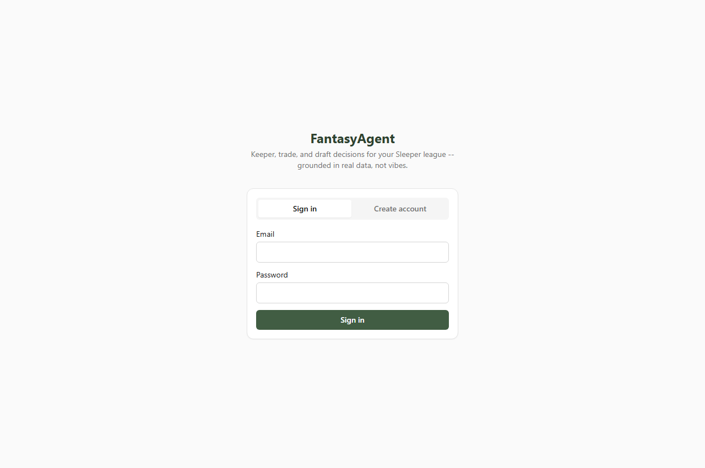
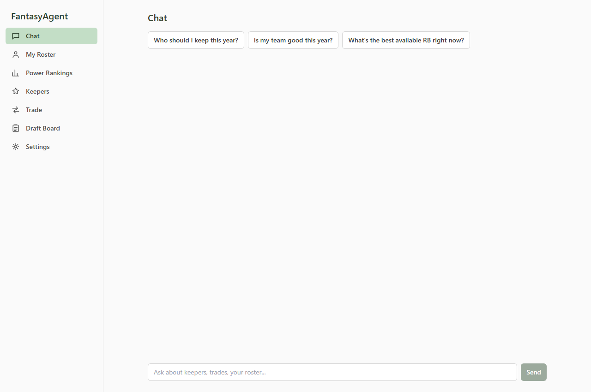
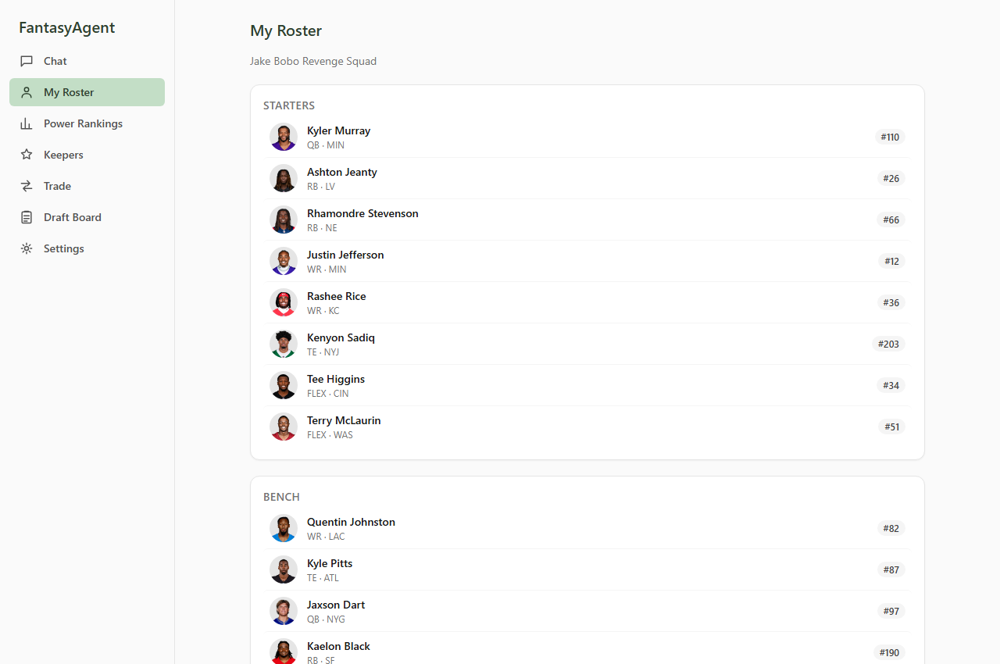
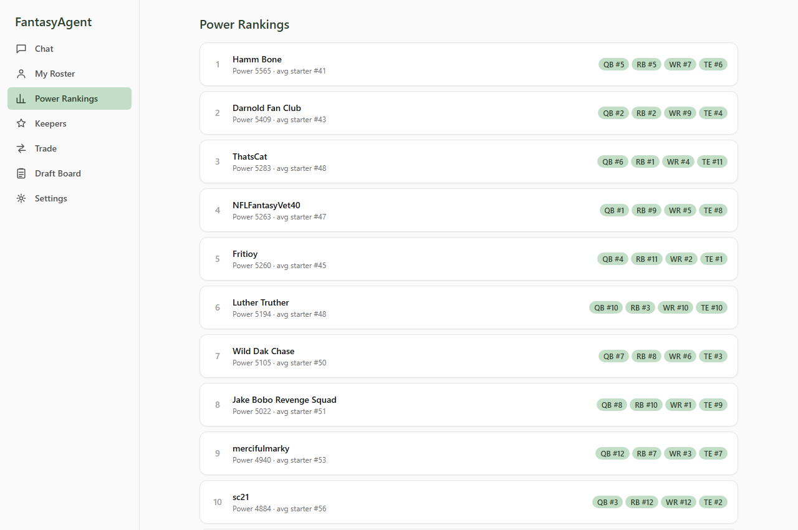
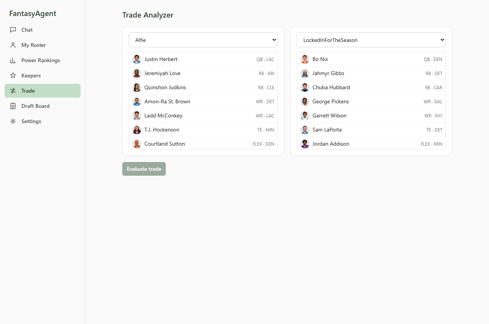
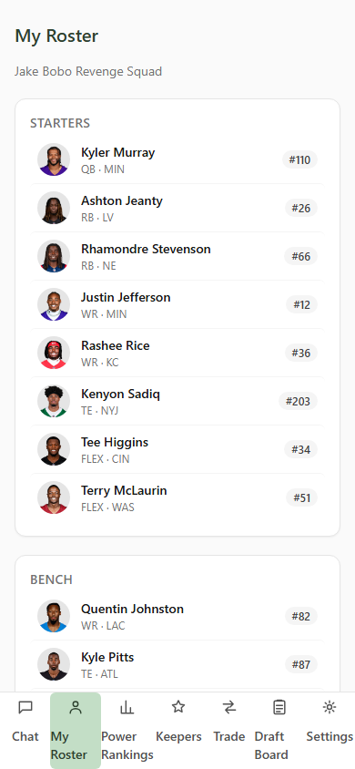

# Fantasy Agent

An AI agent that helps manage a 12-team PPR superflex keeper league on Sleeper. It answers
questions like "should I keep Bijan or draft fresh," "is this trade fair," and "who's the best
player available right now" by pulling live league/player data and reasoning over it with
GPT-5.6 Luna's tool-calling (OpenAI's Responses API) — not a static value chart, and not a
chatbot wrapper.

Originally a CLI + two Tkinter desktop GUIs; now a React + TypeScript web app over a FastAPI
backend, with the original CLI and domain logic unchanged underneath. See
[fantasy-agent-spec.md](fantasy-agent-spec.md) for the original project spec and
[CLAUDE.md](CLAUDE.md) for the web migration spec both halves were built from.

## Screenshots

| | |
|---|---|
|  |  |
|  |  |
|  |  |

**Live demo:** not deployed yet — everything needed to deploy (Dockerfile, Postgres compatibility,
hosting config) is built and verified locally; see [CLAUDE.md section 7.3](CLAUDE.md#73-hosting)
for the remaining checklist (it needs real accounts on a hosting provider, which only you can set up).

## Status

Complete, following the web migration spec's build order ([CLAUDE.md](CLAUDE.md) section 8):

1. Sleeper API integration + local cache (league, rosters, users, players, draft history)
2. FantasyPros rankings scraper + player-ID matching
3. Keeper decision logic + trade analyzer (validated as pure data pipelines, no LLM)
4. GPT-5.6 Luna tool-calling agent wired to the above
5. Draft-day best-available assistant (live-polled, superflex-aware)
6. FastAPI backend wrapping all of the above as a JSON API, with real account auth
7. React + TypeScript frontend (all 7 pages, mobile-responsive, light/dark mode)
8. Deploy-readiness: Dockerfile, docker-compose, verified Postgres compatibility
9. Cleanup: the two Tkinter desktop GUIs retired (full history still in `git log`)

## Architecture

```
  Browser (React + TypeScript, Vite)
        |
        |  HTTPS, JSON (/api/*) -- every route but /api/health and /api/auth/*
        |  requires a signed-in account
        v
  FastAPI app (backend/app)
   - routers: auth, league, roster, rankings, keepers, trade, draft, players, sync, agent
   - Pydantic response models; bcrypt + revocable session tokens for accounts
        |
        |  plain Python function calls -- backend never rewrites domain logic
        v
  fantasy_agent package (unchanged domain layer, also the CLI's entrypoint)
   - keeper.py, trade.py, draft.py, power_rankings.py, my_roster.py (pure, no LLM)
   - agent/core.py + agent/tools.py (GPT-5.6 Luna tool-calling loop)
   - sync.py, rankings/ (FantasyPros), sleeper/ (API client)
        |
        v
  SQLite (local dev)  /  PostgreSQL (deployment)
```

The CLI (`fantasy-agent ...`) and the web API are two front doors onto the same domain layer —
neither the pipelines, the agent loop, nor the Sleeper/FantasyPros clients changed to support the
web migration. See "Why a manual tool-calling loop" and the rest of this README for the parts
that are genuinely unchanged since the original CLI-only build.

## Setup

Needs both halves running for the web app; the CLI only needs the first.

### Backend

```bash
python -m venv .venv
./.venv/Scripts/activate        # macOS/Linux: source .venv/bin/activate
pip install -e ".[web,dev]"
cp .env.example .env            # defaults already point at the real league
```

`OPENAI_API_KEY` in `.env` is only required for the agent (`fantasy-agent ask` / the Chat page).
Everything else works against the local cache with no API key.

```bash
uvicorn backend.app.main:app --reload    # http://localhost:8000, docs at /docs
```

### Frontend

```bash
cd frontend
npm install
npm run dev    # http://localhost:5173, proxies /api to localhost:8000
```

First visit shows a sign-in/create-account screen — every page past that requires a signed-in
account (enforced by the backend, not just hidden in the UI). Create one, then from **Settings**
click **Sync league** and **Sync rankings** to populate real data.

### Full stack against Postgres (optional)

```bash
docker compose up    # backend + a real Postgres container
```

Still run the frontend separately via `npm run dev` — Vite's dev server + HMR beats a built
static container for day-to-day work. This is for exercising the backend against the same
database engine a deployment would use; see `docker-compose.yml`'s comments.

## Usage

### CLI (unchanged since the original MVP)

```bash
# --- Data layer: pull everything into the local cache ---
fantasy-agent sync                          # league, rosters, users, players, draft history
fantasy-agent league                        # cached league settings
fantasy-agent rosters                       # power-rank every team 1-N, with QB/RB/WR/TE breakdown
fantasy-agent rosters --detail              # + each team's best starting lineup
fantasy-agent players --search "mahomes"    # sanity-check the player cache

# --- Rankings: scrape FantasyPros, match to Sleeper player IDs ---
fantasy-agent rankings-sync                 # scrape + match (rate-limited, cached ~20h)
fantasy-agent rankings-show --search "mahomes"
fantasy-agent rankings-unmatched            # players the matcher couldn't resolve
fantasy-agent rankings-alias <fp_id> <sleeper_id>   # manual override for a bad/no match

# --- Pure data-pipeline tools (no LLM) ---
fantasy-agent keepers                       # rank your roster's keeper candidates
fantasy-agent trade --side-a-owner <id> --side-a-gives p1,p2 \
                     --side-b-owner <id> --side-b-gives p3
fantasy-agent best-available                # live draft board (polls Sleeper fresh every call)

# --- The agent itself ---
fantasy-agent ask "should I keep Bijan Robinson or draft fresh?"
```

`players/nfl` is a multi-MB dump Sleeper asks callers not to poll frequently, so it's only
re-pulled when the cache is older than `PLAYERS_CACHE_TTL_HOURS` (default 24h; `sync
--force-players` bypasses that during draft week). FantasyPros rankings are cached the same
way, on `RANKINGS_CACHE_TTL_HOURS`. The agent never scrapes or hits Sleeper live mid-conversation
— with one deliberate exception: `best-available` polls the draft endpoint fresh on every call,
because "who's been picked" can't be allowed to go stale during a live draft.

### Web app

Seven pages: **Chat** (the agent, with a "Show reasoning" toggle over the tool-call trace), **My
Roster**, **Power Rankings**, **Keepers**, **Trade Analyzer** (pick two teams — each side's actual
roster loads automatically as the player picker, so you can only pick players that team really
owns), **Draft Board** (a "Live" toggle polls every 15s), and **Settings** (account, league
override for testing against a different Sleeper league without restarting the backend, sync
status/triggers, demo access code). Sidebar nav on desktop, bottom tab bar on mobile; full
light/dark mode.

## Tests

```bash
pytest                              # domain layer + CLI (83 tests)
pytest backend/tests                # FastAPI routes (51 tests)
cd frontend && npm test             # React components (9 tests)
```

All offline — Sleeper and FantasyPros HTTP calls are mocked with `httpx.MockTransport`, the OpenAI
client is mocked in `test_agent_core.py` (fake Responses API `output`/`function_call` objects),
and the backend tests run against an in-memory SQLite database with a throwaway auto-authenticated
test account — the suite needs no network access, API key, or live league. Keeper/trade/draft
logic, the full backend API, and Postgres compatibility are additionally validated against the
real league's live data during development (see commit history / session notes) — sane,
explainable output on real rosters is the actual bar per the spec, not just green tests.

## Project layout

```
src/fantasy_agent/      # unchanged domain layer -- also the CLI's entrypoint
  config.py             # env-based settings
  sleeper/               # Sleeper API client + response schemas
  rankings/              # FantasyPros scraper, player-ID matching, response schemas
  db/                    # SQLAlchemy models + session (SQLite/Postgres; lazily initialized)
  sync.py                # pulls Sleeper + FantasyPros data into the local cache
  roster_analysis.py     # shared position-count/need helpers
  my_roster.py           # full single-team roster view (starters/bench/IR/taxi)
  keeper.py              # keeper decision logic (pure, no LLM)
  trade.py               # trade analyzer (pure, no LLM)
  draft.py               # live best-available draft assistant (pure, no LLM)
  power_rankings.py      # league-wide power rankings + positional breakdown (pure, no LLM)
  player_analysis.py     # last-N-games PPR trend for the player detail panel
  agent/
    tools.py             # tool schemas + handlers exposed to the model
    core.py              # the manual tool-calling loop + run_agent_with_trace()
  cli.py                 # `fantasy-agent` entrypoint
backend/
  app/
    main.py, deps.py, schemas.py, auth.py, jobs.py
    routers/             # auth, league, roster, rankings, keepers, trade, draft, players, sync, agent
  tests/                 # FastAPI route tests, in-memory SQLite, auto-authenticated client
  Dockerfile
frontend/
  src/
    api/                 # typed fetch client + types
    hooks/                # one hook per endpoint (TanStack Query)
    state/                # AuthContext, LeagueContext, PlayerPanelContext
    components/, pages/
tests/                   # domain-layer + CLI tests
docs/screenshots/        # this README's screenshots
CLAUDE.md                # web migration spec (phases, design decisions, open questions)
fantasy-agent-spec.md    # original CLI/agent MVP spec
docker-compose.yml        # backend + Postgres for local full-stack runs
.github/workflows/        # daily-sync.yml -- scheduled POST /api/sync once deployed
```

## Architecture notes (unchanged from the original CLI build)

The agent doesn't do one API call and hand it to the model — `agent/core.py` runs an explicit
loop against OpenAI's Responses API (`client.responses.create`), feeding each round's output back
in as input until the model stops requesting tools. The model decides which of the 9 tools in
`agent/tools.py` it needs for a given question, the handler runs against the local cache (or, for
`get_best_available`, a live Sleeper call), and the result goes back as a `function_call_output`
for the model to reason over — possibly triggering more tool calls — before it answers. Every tool
call and result is logged (`INFO fantasy_agent.agent.core`) and, via the web API's
`run_agent_with_trace()`, surfaced in the Chat page's "Show reasoning" toggle — both a debugging
aid and the "here's how it thinks" trace worth showing in an interview.

### Why a manual tool-calling loop

This project is deliberately hand-rolled rather than reaching for a higher-level agent-loop
helper: the point of the build is the agentic tool-selection logic itself, and a manual loop
keeps every tool call, its input, and its result directly visible and logged rather than hidden
inside SDK internals.

### Why keeper/trade/draft logic is *not* LLM calls

`keeper.py`, `trade.py`, and `draft.py` are plain Python functions — deterministic, unit-tested,
and validated against the real league *before* any LLM was wired in. The model's job is to decide
*when* to call them and to explain the result in context, not to recompute a keeper cost or trade
value itself (which an LLM would do inconsistently and unverifiably). This split — deterministic
pipeline underneath, LLM for tool selection and explanation on top — is the core design decision
of the project, and it's also why the web migration (Phases 1-5) never touched these files: the
backend just calls the same functions the CLI already did.

### Note on provider

The agent originally ran on Claude (Anthropic's Messages API); it was later switched to OpenAI's
Responses API (`gpt-5.6-luna`). The swap only touched `agent/core.py` (the request/response loop
mechanics) and the tool-schema shape in `agent/tools.py` (Claude's `{name, description,
input_schema}` vs. the Responses API's flat `{type: "function", name, description, parameters}`)
— every tool *handler*, and all of `keeper.py`/`trade.py`/`draft.py`/`power_rankings.py`, needed
zero changes, since those never import a provider SDK at all. One functional difference worth
knowing: Claude's Messages API needed explicit `cache_control` breakpoints to get prompt-caching
discounts; the Responses API prices repeated prefixes at a discounted "cached input" rate
automatically, so there's no client-side cache bookkeeping to do here.

### Data sources and caching

| Source | What | Cache policy |
|---|---|---|
| Sleeper API | league, rosters, users, full player DB, draft history | `sync`; players/nfl gated by TTL (large, rate-sensitive) |
| Sleeper API | current draft's live picks | **never cached** — polled fresh every `best-available` call |
| FantasyPros | dynasty/superflex consensus rankings | `rankings-sync`; TTL-gated, scraped politely (see below) |

**FantasyPros scraping approach.** The spec called for Playwright, matching prior scraping
experience — but FantasyPros' rankings pages embed the full ranked-player list as a JSON blob
directly in a `<script>` tag (`var ecrData = {...}`), so a plain `httpx` GET plus a
balanced-brace JSON extraction (`rankings/fantasypros.py`) gets the same data without a headless
browser. `robots.txt` disallows the interactive `/nfl/ranker/` tool but not `/nfl/rankings/`
pages, and asks for a 5s crawl-delay; the scraper pulls one page per `rankings-sync` run and is
always read from cache during agent conversations, never scraped on demand.

**Player-ID matching** (`rankings/matching.py`) is the fiddly part the spec calls out. FantasyPros
and Sleeper name players differently (suffixes, punctuation, nicknames) and represent defenses
differently (team name vs. bare team code). Matching runs in priority order: manual alias
override → defense-by-team-code → exact normalized-name match → fuzzy match — with unmatched
players surfaced via `rankings-unmatched` rather than silently dropped, and a `rankings-alias`
command to fix them. On the real league this resolves ~98.6% of players automatically; the
holdouts are genuinely ambiguous cases (e.g. "Frank Gore Jr." colliding with a retired "Frank
Gore" already in Sleeper's DB).

**Keeper cost model** (`keeper.py`). Sleeper doesn't expose a keeper-cost field — round-penalty
rules are commissioner-defined and live outside the API. Cost is modeled as
`max(1, round_drafted - KEEPER_ROUND_PENALTY)`, where `round_drafted` comes from the most recent
*completed* draft in the league's `previous_league_id` chain (the current season's draft is
usually still `pre_draft` when you're deciding keepers, so last season's draft is the real cost
basis). Undrafted players (waiver/FA adds) default to the last round. "Value" of keeping a player
is a simple opportunity-cost comparison against the replacement-level player you'd expect at that
draft slot — explainable, not a precise valuation model.

**Trade value model** (`trade.py`). Each player's rank is converted to a comparable value via a
monotonic exponential decay curve, similar in spirit to public dynasty trade charts. Roster-need
impact (does the trade fill a hole or add to a surplus) is computed from before/after position
counts against the league's starter requirements.

**Superflex-awareness in the draft assistant** (`draft.py`) comes from the data source, not extra
logic: rankings are scraped from FantasyPros' *superflex* consensus page, so QBs are already
valued the way a 2-QB/superflex market values them. The draft assistant's own job is narrower —
exclude already-drafted and already-rostered players, and annotate each remaining one with how it
fits your roster's current position counts.

**Power rankings** (`power_rankings.py`). Ranks every team 1..N by the value of its best possible
*starting* lineup, not total roster value (which would just reward bench-hoarding). Filling
FLEX/SUPER_FLEX is a greedy assignment — exact-position slots first with each position's best
remaining player, then FLEX from what's left at RB/WR/TE, then SUPER_FLEX from what's left at
QB/RB/WR/TE — rather than a true optimal-assignment solver; good enough in practice and easy to
explain (and it's what correctly stacks a second elite QB into SUPER_FLEX over a worse flex
option). Alongside the overall rank, each team also gets a QB/RB/WR/TE positional rank computed
from *whole-roster* value at that position — this is what actually answers "where is this team
strong or thin," since a team can have a great starting lineup while sitting on zero bench depth
at a position, or vice versa. Both use the same `trade.player_value` curve as the trade analyzer,
so power rankings and trade values stay on one consistent scale.

### Accounts (new in the web migration)

Every route but `/api/health` and `/api/auth/*` requires a signed-in account — enforced by a
FastAPI dependency server-side, not just a frontend screen. Passwords are bcrypt-hashed; sessions
are opaque, revocable bearer tokens (not JWTs) with a 30-day TTL, specifically so logout actually
invalidates one server-side. See [CLAUDE.md section 5.10](CLAUDE.md#510-accounts) for the full
design, including the deliberate gaps (no email verification, password reset, or login rate
limiting — fine for a personal/portfolio deployment, real gaps for anything wider) and the 401-vs-
403 split that lets the account gate and the separate demo-access-code gate (on the agent/sync
routes specifically, since those cost real money per call) coexist without one tripping the other.

## Success criteria (from the spec)

- Actually usable for real keeper decisions and this season's draft
- Reasoning explainable enough to trust — every recommendation cites the specific numbers behind
  it, not just a verdict
- This README as the architecture/portfolio writeup
